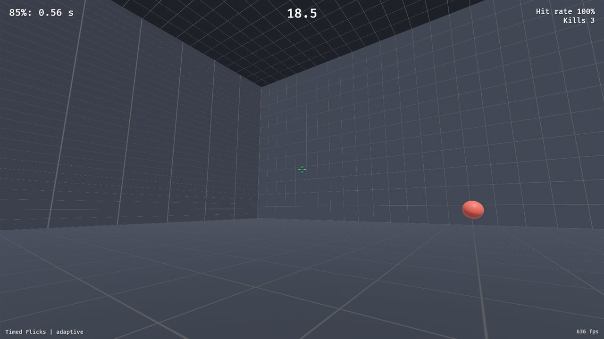
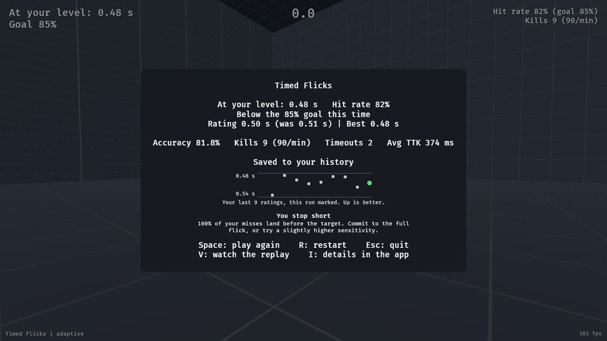
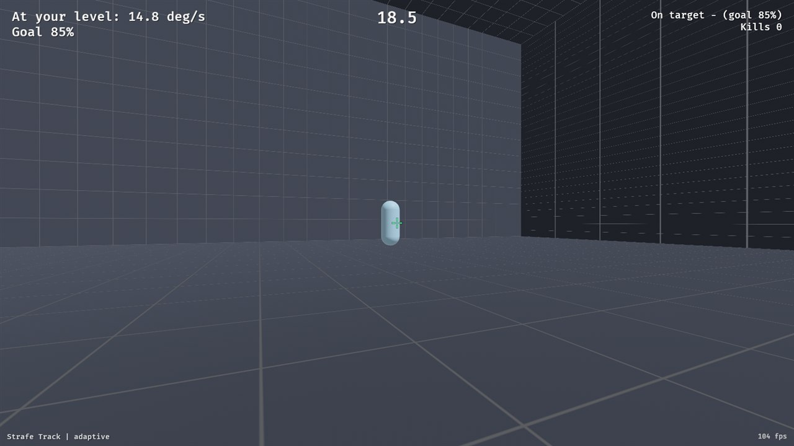
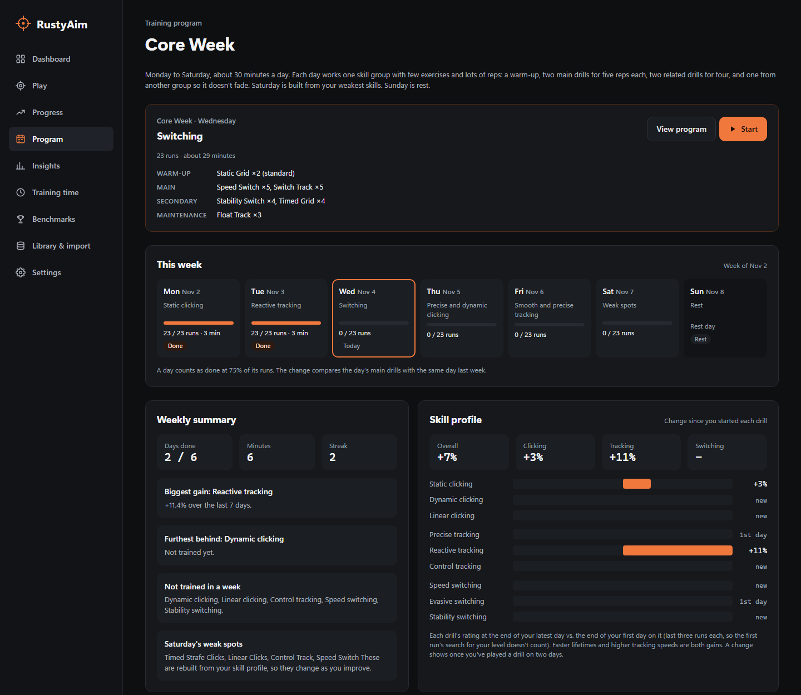
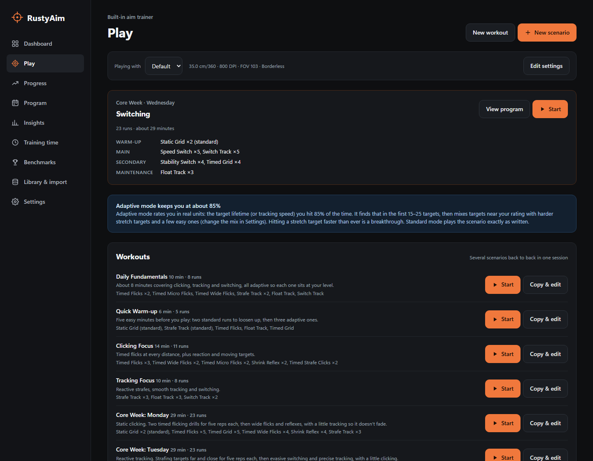
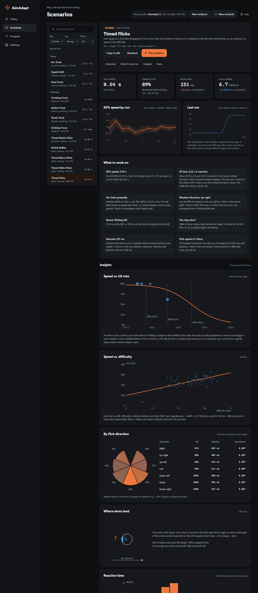
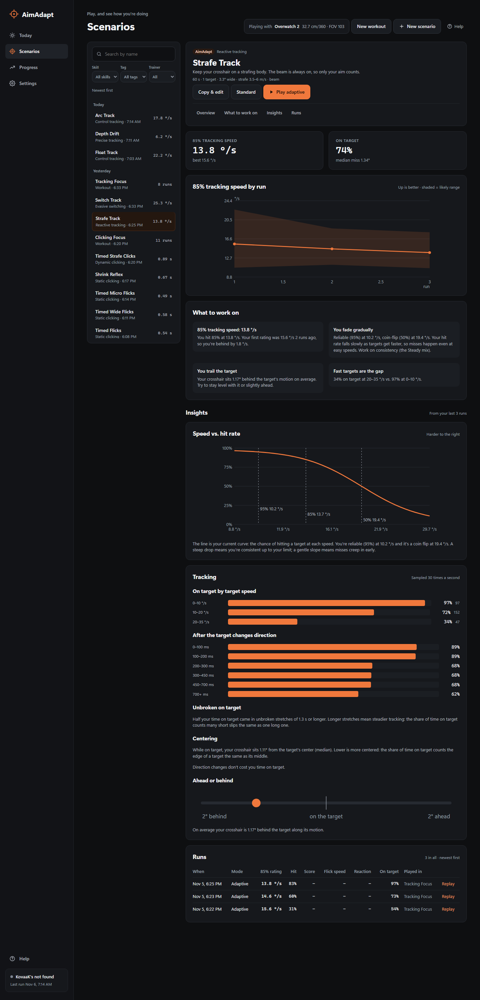
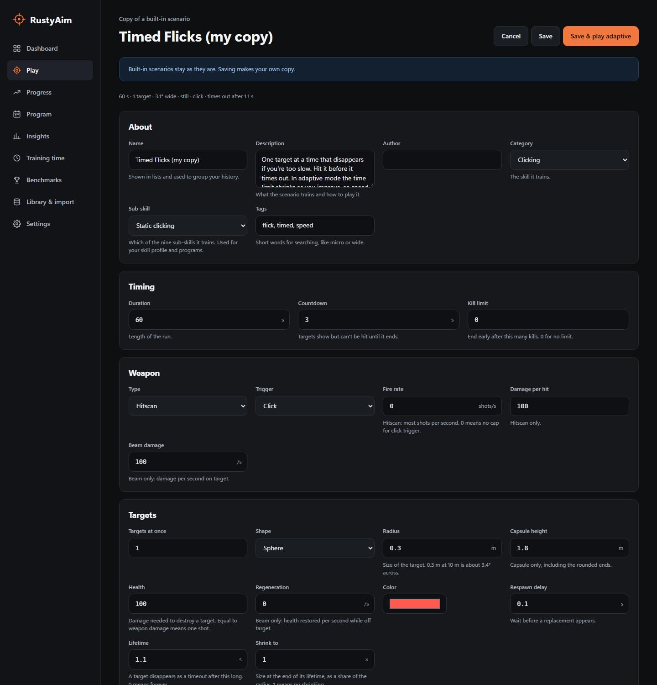
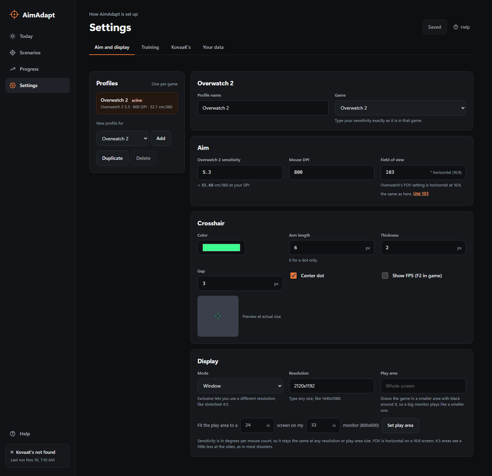

# AimAdapt

An aim trainer for Windows. It rates you in real units (target lifetime in seconds, tracking speed in degrees per second), keeps each drill at the difficulty you hit about 85% of the time, runs a weekly training program, and records every target and shot for analytics. It can also import KovaaK's stats files.

Screenshots use demo data played by the built-in test bot.



The app's Help page has the full [user guide](crates/aimadapt-app/ui/guide.md): every page, the trainer's keys, how ratings work, and what each built-in scenario trains.

## Download

Download `AimAdapt_<version>_x64-portable.exe` from [releases](../../releases) and run it. There's nothing to install. A setup .exe and an .msi are attached too, if you want a Start menu entry and an uninstaller.

Requirements: Windows 10 or 11 with the WebView2 runtime (included with Windows 11 and current Windows 10), and a GPU that supports Vulkan or DirectX 12.

## Trainer

- Separate full-screen window with raw mouse input and no frame cap.
- Sensitivity in cm/360 and DPI, or in a game's own units (Overwatch 2, Valorant, Counter-Strike 2, Apex Legends, Call of Duty).
- FOV is horizontal at 16:9.
- Display: borderless, exclusive full screen at any resolution and refresh rate the monitor supports (for example stretched 4:3), or windowed.
- Optional play area, so a large monitor can play at the size of a smaller one. It's centered, or placed where you like (for example near the top of the screen).
- The mouse locks to the game again as soon as you're back from another window.
- The game window opens over the app window: centered across it, with the tops level, and full screen goes on the app's monitor.
- 29 built-in scenarios across nine sub-skills, at least two for each:
  - **Clicking:** static, dynamic, linear.
  - **Tracking:** precise, reactive, control.
  - **Switching:** speed, evasive, stability.
- Hitscan and beam weapons; click, hold or always-on triggers.
- Sphere and capsule targets, with optional lifetime, shrink, and health regeneration with a delay.
- Timed targets show a time-left bar and change color by wave (three red, then three blue, then three red on Timed Grid), so newer targets stand out from older ones. Optional health bars.
- Movement: still, strafing, random or curved (steady speed with a turning heading, on Control Track), with optional acceleration (targets slow down and speed back up at each turn, and random turns curve), movement toward and away from you, and jumps with gravity.



## Adaptive mode

Each scenario has one difficulty setting, chosen for what it trains: target lifetime for timed clicking, kill pace for grids, untimed flicks and speed switching, target size for precision (Micro Flicks, Precise Track), and target speed for tracking and strafe clicking. Adaptive mode estimates the value you succeed at 85% of the time, along with how certain that estimate is.

- **How it updates:** a Bayesian estimate similar to Glicko. A surprising result moves the rating more than an expected one. The next run starts from your last rating on the same version of the scenario, and the uncertainty grows with the days since you last played. Changing a scenario's settings starts it over.
- **Calibration run:** your first adaptive run on a scenario changes difficulty as you play, to find your level within the run.
- **One difficulty per run after that:** every later run plays at a single value for the whole run, shown at the start ("This run: 0.62 s"). The value is picked by chance of success:

  | Run | Chance of success | Balanced |
  |---|---|---|
  | At your level | 80–90% | 65% |
  | Stretch | 55–72% | 20% |
  | Easy | 93–97% | 15% |

  The Steady and Push mixes change these shares. A stretch run never follows another stretch run, or a run well below 85%.
- **Breakthroughs:** holding 85% for a whole run at a value harder than your best.
- **What counts:**
  - **Clicking:** a target is a success if it's destroyed before it times out, with at most one miss on it.
  - **Tracking:** each 2-second segment is scored by the share of time spent on target. Stability Switch and Switch Track only count time while a target is damaged and not yet healed, so moving between targets isn't counted against you. Their targets show health bars and heal when you leave them.
  - **Finished in time (Unbroken Strafes, Unbroken Float):** each target needs a stretch of beam and heals fast when you slip off. A target finished before it times out is a success, so only unbroken tracking counts. The rating is the target speed at which you finish 85% of them.
  - **Kill pace (Speed Switch, Static Grid, Timed Grid, Wide Flicks):** a kill within the pace of the one before is a success; each full stretch of that length with no kill is a failure. When clicking, a kill after a spray of misses doesn't count.

Standard mode plays a scenario exactly as written and scores points.



## Program

Core Week is a six-day plan. Each day takes about 29 minutes.

| Day | Focus |
|---|---|
| Monday | Static clicking |
| Tuesday | Reactive tracking |
| Wednesday | Switching |
| Thursday | Precise and dynamic clicking |
| Friday | Smooth and precise tracking |
| Saturday | Weak spots |
| Sunday | Rest |

Every day uses five drills, with reps instead of variety. Most drills alternate week by week with a variant that trains the same sub-skill (for example Strafe Track and Hop Strafe Track), so reps build skill without fitting one exact setup:

| Block | Drills | Reps each |
|---|---|---|
| Warm-up | 1 | 2 |
| Main | 2 | 5 |
| Secondary | 2 | 4 |
| Maintenance | 1 (another skill group) | 3 |

Saturday's drills are chosen from your weakest sub-skills.



The Program page shows:
- **This week:** each day as done, partial or missed, with minutes, and the day's main drills compared with the same day last week. A missed day can be made up later in the week.
- **Skill profile:** the change in each of the nine sub-skills, each group and overall. It's measured from the end of your first day on each drill.
- **Weekly summary:** days done, minutes, streak, biggest gain, the skill furthest behind, and skills not trained in a week.
- **Reps and carry-over:** rep 1 vs. the last rep of each drill, and how much of the previous session's rating carried over.

The Play screen shows today's workout with a Start button.



## Insights

Every run stores each target, each shot, tracking samples 30 times a second, and a 240 Hz aim trace. Insights shows, per scenario:

- **Rating by run** with its likely range, and how it moved during the last run.
- **Speed vs. hit rate curve:** where you're reliable (95%), your 85% rating, and the coin-flip point (50%), with observed hit rates.
- **Flick speed:** time to kill vs. difficulty, as a Fitts' law fit and throughput in bits per second.
- **By direction and distance:** hit rate and median time in 8 flick directions and 5 distance bands.
- **Shot placement** relative to the target, aligned to the flick direction: overshooting vs. stopping short, and any vertical bias.
- **Reaction time:** a histogram, with the median compared with earlier runs. On lifetime ratings a note splits the rating into your reaction time and the part you control, which improves by more than the rating shows.
- **Tracking:** time on target by target speed, recovery after direction changes, how far ahead of or behind the target you are, unbroken stretches on target (half your time on target came in stretches at least this long), and centering (median distance from the target's center while on it).
- **Within a run:** success in 10-second segments.
- **Notes** generated from the figures above.





## Scenarios, workouts and settings

- **Scenarios** are TOML files. The editor is a form built from the engine's list of supported fields, and checks values as you type. Built-in scenarios are copied before editing. [SCENARIOS.md](SCENARIOS.md) documents every field, the adaptive settings, workouts and programs.
- **Workouts** are lists of scenarios with a run count and a mode for each, played back to back in one session.
- **Settings profiles** each hold sensitivity, DPI, FOV, adaptive mix, crosshair and display settings, typically one per game. The first profile is matched to your latest KovaaK's run, if there is one.





## KovaaK's import

If KovaaK's is installed, AimAdapt imports its per-run stats files from your Steam libraries, and keeps importing new ones while it's open. The Dashboard, Progress, Training time and Benchmarks screens cover those runs together with standard-mode trainer runs:
- Personal bests, trends and plateaus.
- Sessions and active time.
- Streaks and a daily goal.
- Sensitivity history.

The `aimadapt-cli` command line tool shows the same reports.

## Data

Everything is stored locally in `%APPDATA%\AimAdapt`:
- `aimadapt.db`: SQLite.
- `engine.toml`: settings profiles.
- `scenarios\` and `workouts\`: your own files.

Nothing is sent anywhere.

AimAdapt used to be called RustyAim. On its first run it moves `%APPDATA%\RustyAim` to `%APPDATA%\AimAdapt` and renames the database, so your history, ratings, profiles and files carry over. Runs keep `source = 'rustyaim'` inside the database.

## Development

Needs Rust (stable, MSVC toolchain) and the Visual Studio C++ build tools.

| Crate | Contents |
|---|---|
| `aimadapt-core` | KovaaK's parsing, SQLite storage, reports, Insights and program progress |
| `aimadapt-sim` | Scenario format, field list, simulation, adaptive rating, workouts and programs. No graphics. |
| `aimadapt-engine` | The Bevy trainer window and saving runs |
| `aimadapt-app` | The Tauri desktop app. The UI is plain HTML/CSS/JS in `ui/`. |
| `aimadapt-cli` | Command line reports |

Running the app with `--play`, `--workout` or `--program` starts the trainer instead, so the release is a single exe.

```bash
cargo run -p aimadapt-app
```

```bash
cargo run -p aimadapt-engine -- builtin:timed-flicks --adaptive --windowed
```

Run the tests:

```bash
cargo test --workspace
```

Enable the pre-commit hook once per clone. It checks formatting, runs clippy and the tests, and builds `dist/AimAdapt.exe`:

```bash
git config core.hooksPath .githooks
```

Testing tools:
- **Bot test:** `--smoke <folder>` has a bot play short runs and save screenshots. `--smoke-seconds` sets the run length.
- **Separate database:** `--db <file>` keeps test runs out of your own data. The app also takes `--no-import` to skip KovaaK's.
- **Browser preview:** `cargo run -p aimadapt-app -- --dump-snapshot crates/aimadapt-app/ui/dev-snapshot.json`, then `python -m http.server 8765 --directory crates/aimadapt-app/ui`.

[TESTING.md](TESTING.md) has the test plan and [BACKLOG.md](BACKLOG.md) has the roadmap.

Before a release, bump the version line in the [user guide](crates/aimadapt-app/ui/guide.md) and check its What's new section; a test fails until the guide's version matches. Pushing a version tag (`git tag v0.2.0` then `git push origin v0.2.0`) runs `.github/workflows/release.yml`. It builds the portable exe and both installers and attaches them to a GitHub release.

If the repo is in a synced folder like OneDrive, move build output out of it with a local, gitignored `.cargo/config.toml` containing `[build]` and `target-dir = "C:/some/other/folder"`.

## License

MIT. See [LICENSE](LICENSE).
