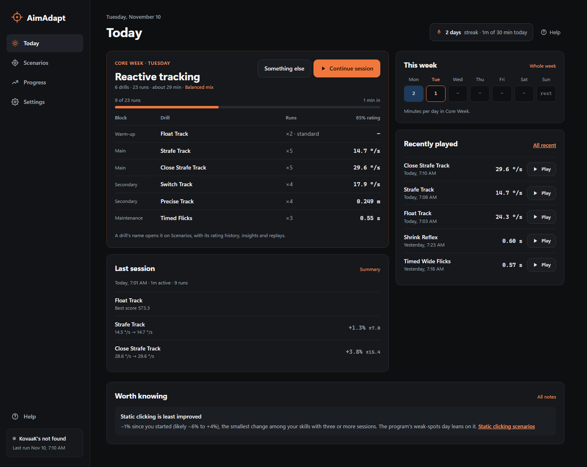
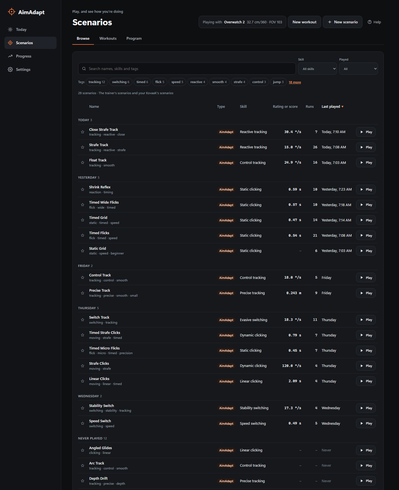
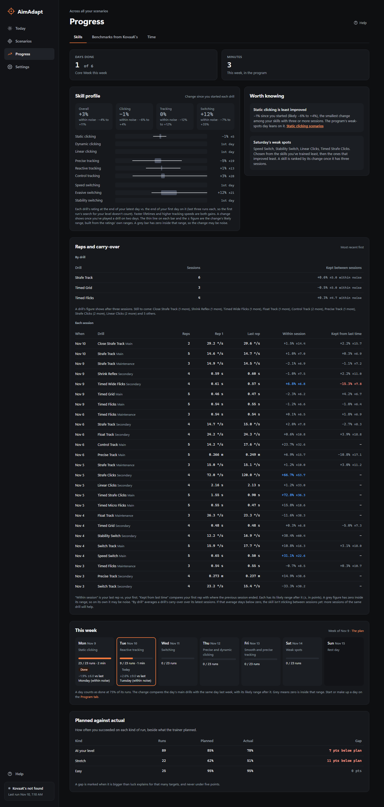

# AimAdapt

An aim trainer for Windows. It rates you in real units (target lifetime in seconds, tracking speed in degrees per second), keeps each drill at the difficulty you hit about 85% of the time, runs a weekly training program, and records every target and shot for analytics. It can also import KovaaK's stats files.

Screenshots use demo data played by the built-in test bot.


The app's Help page has the full [user guide](crates/aimadapt-app/ui/guide.md): every page, the trainer's keys, how ratings work, and what each built-in scenario trains.

## Download

Download `AimAdapt_<version>_x64-portable.exe` from [releases](../../releases) and run it. There's nothing to install. A setup .exe and an .msi are attached too, if you want a Start menu entry and an uninstaller.

Requirements: Windows 10 or 11 with the WebView2 runtime (included with Windows 11 and current Windows 10), and a GPU that supports Vulkan or DirectX 12.

## Trainer

- Separate full-screen window with raw mouse input and no frame cap.
- Sensitivity in cm/360 and DPI, or in a game's own units (Overwatch 2, Valorant, Counter-Strike 2, Apex Legends, Call of Duty).
- FOV is horizontal at 16:9.
- Display: borderless, exclusive full screen at any resolution and refresh rate the monitor supports (for example stretched 4:3), or windowed.
- Optional play area, so a large monitor can play at the size of a smaller one. It's centered, or placed where you like (for example near the top of the screen).
- The mouse locks to the game again as soon as you're back from another window.
- The game window opens over the app window: centered across it, with the tops level, and full screen goes on the app's monitor.
- 29 built-in scenarios across nine sub-skills, at least two for each:
  - **Clicking:** static, dynamic, linear.
  - **Tracking:** precise, reactive, control.
  - **Switching:** speed, evasive, stability.
- Hitscan and beam weapons; click, hold or always-on triggers.
- Sphere and capsule targets, with optional lifetime, shrink, and health regeneration with a delay.
- Timed targets show a time-left bar and change color by wave (three red, then three blue, then three red on Timed Grid), so newer targets stand out from older ones. Optional health bars.
- Movement: still, strafing, random or curved (steady speed with a turning heading, on Control Track), with optional acceleration (targets slow down and speed back up at each turn, and random turns curve), movement toward and away from you, and jumps with gravity.


## Adaptive mode

Each scenario has one difficulty setting, chosen for what it trains: target lifetime for timed clicking, kill pace for grids, untimed flicks and speed switching, target size for precision (Micro Flicks, Precise Track), and target speed for tracking and strafe clicking. Adaptive mode estimates the value you succeed at 85% of the time, along with how certain that estimate is.

- **How it updates:** a Bayesian estimate similar to Glicko. A surprising result moves the rating more than an expected one. The next run starts from your last rating on the same version of the scenario, including how well your consistency is known, so a steady player's rating holds still between runs. The uncertainty grows with the days since you last played. Changing a scenario's settings starts it over.
- **Calibration run:** your first adaptive run on a scenario changes difficulty as you play, to find your level within the run.
- **One difficulty per run after that:** every later run plays at a single value for the whole run, shown at the start ("This run: 0.62 s"). The value is picked by chance of success:

  | Run | Chance of success | Balanced |
  |---|---|---|
  | At your level | 80–90% | 65% |
  | Stretch | 55–72% | 20% |
  | Easy | 93–97% | 15% |

  The Steady and Push mixes change these shares. A stretch run never follows another stretch run, or a run well below 85%.
- **Breakthroughs:** holding 85% for a whole run at a value harder than your best.
- **What counts:**
  - **Clicking:** a target is a success if it's destroyed before it times out, with at most one miss on it.
  - **Tracking:** each 2-second segment is scored by the share of time spent on target. Stability Switch and Switch Track only count time while a target is damaged and not yet healed, so moving between targets isn't counted against you. Their targets show health bars and heal when you leave them.
  - **Finished in time (Unbroken Strafes, Unbroken Float):** each target needs a stretch of beam and heals fast when you slip off. A target finished before it times out is a success, so only unbroken tracking counts. The rating is the target speed at which you finish 85% of them.
  - **Kill pace (Speed Switch, Static Grid, Timed Grid, Wide Flicks):** a kill within the pace of the one before is a success; each full stretch of that length with no kill is a failure. When clicking, a kill after a spray of misses doesn't count.

Standard mode plays a scenario exactly as written and scores points.


## Program

Core Week is a six-day plan. Each day takes about 29 minutes.

| Day | Focus |
|---|---|
| Monday | Static clicking |
| Tuesday | Reactive tracking |
| Wednesday | Switching |
| Thursday | Precise and dynamic clicking |
| Friday | Smooth and precise tracking |
| Saturday | Weak spots |
| Sunday | Rest |

Every day uses five drills, with reps instead of variety. Most drills alternate week by week with a variant that trains the same sub-skill (for example Strafe Track and Hop Strafe Track), so reps build skill without fitting one exact setup:

| Block | Drills | Reps each |
|---|---|---|
| Warm-up | 1 | 2 |
| Main | 2 | 5 |
| Secondary | 2 | 4 |
| Maintenance | 1 (another skill group) | 3 |

Saturday's drills are chosen from your weakest sub-skills.

Today shows today's day. Scenarios › Program shows the whole week, with every day's drills and a start button on each. Progress › Skills shows how the week went.

## The app

Four pages, in the sidebar:

- **Today:** today's program workout with each drill's runs and 85% rating, and Start session, Continue session or Repeat session. Also the week at a glance (**Whole week** opens the Program tab), your favorites and what you played last (each with Play, or Start session for a workout), and the top note from your history.
- **Scenarios:** everything you can play or have played (the trainer's scenarios, your workouts and your KovaaK's scenarios) in five tabs across the page: Recent (newest first, by day), Browse (every scenario, the trainer's and your KovaaK's files, by skill, with tag chips), Workouts, Program (the week's plan: a card for each day with its drills, your progress and a Start session button) and Yours. The four lists are tables you can sort by any column, with a search over names, skills, tags and descriptions and filters for skill, type, played or not, and favorites. Star favorites and hide what you don't want listed. Each scenario and workout has its own page: Play (adaptive) and Standard run at the top with your latest rating, then three tabs: Overview (key figures, rating chart, latest runs and a few notes), Insights (what to work on and the charts below) and Runs (every run, with replays). A KovaaK's scenario's page has Overview (score history) and Runs.
- **Progress:** three tabs.
  - **Skills:** the skill profile (the change in each of the nine sub-skills, each group and overall, measured from the end of your first day on each drill) beside the notes (every note, most important first), reps and carry-over (rep 1 against the last rep of each drill, and how much of the previous session's rating carried over), and the week's results (each day done, partial or missed, its minutes and its main drills against the same day last week).
  - **Benchmarks from KovaaK's:** your Voltaic Season 5 bests, read from your KovaaK's stats.
  - **Time:** totals, daily time, a calendar and sessions, with a fold for more about when you train.
- **Settings:** four tabs.
  - **Aim and display:** settings profiles.
  - **Goals and time:** the daily goal and how time is counted.
  - **KovaaK's:** the stats folder, import status and sensitivity history.
  - **Your data:** where your files are.

Help is at the bottom of the sidebar, and every page links to its section of the user guide.







## Insights

Every run stores each target, each shot, tracking samples 30 times a second, a 240 Hz aim trace, and where the targets were 60 times a second. Each scenario's page shows the rating by run on its Overview tab and the rest on its Insights tab:

- **Rating by run** with its likely range, and how it moved during the last run.
- **Speed vs. hit rate curve:** where you're reliable (95%), your 85% rating, and the coin-flip point (50%), with observed hit rates.
- **Flick speed:** time to kill vs. difficulty, as a Fitts' law fit and throughput in bits per second.
- **By direction and distance:** hit rate and median time in 8 flick directions and 5 distance bands.
- **Shot placement** relative to the target, aligned to the flick direction: overshooting vs. stopping short, and any vertical bias.
- **Reaction time:** a histogram, with the median compared with earlier runs. On lifetime ratings a note splits the rating into your reaction time and the part you control, which improves by more than the rating shows.
- **Tracking:** time on target by target speed, recovery after direction changes, how far ahead of or behind the target you are, unbroken stretches on target (half your time on target came in stretches at least this long), and centering (median distance from the target's center while on it).
- **Within a run:** success in 10-second segments.
- **Notes** generated from the figures above.

Each run can also be **replayed** from your own view at any speed, with the targets, your shots and the crosshair's trail. Replays are redrawn from the aim trace and the targets' positions, recorded 60 times a second, so they're small and record nothing outside the trainer. Each scenario keeps the replays of its latest 50 runs and of its best run; older runs keep their stats and insights without one.


## Scenarios, workouts and settings

- **Scenarios** are TOML files. The editor is a form built from the engine's list of supported fields, and checks values as you type. Built-in scenarios are copied before editing. [SCENARIOS.md](SCENARIOS.md) documents every field, the adaptive settings, workouts and programs.
- **Workouts** are lists of scenarios with a run count and a mode for each, played back to back in one session.
- **Settings profiles** each hold sensitivity, DPI, FOV, adaptive mix, crosshair and display settings, typically one per game. The first profile is matched to your latest KovaaK's run, if there is one.


## KovaaK's import

If KovaaK's is installed, AimAdapt imports its per-run stats files from your Steam libraries, and keeps importing new ones while it's open. KovaaK's scenarios are on Scenarios' Recent tab with the trainer's, and Progress counts their runs too:
- Personal bests, trends and plateaus, on each scenario's page.
- Sessions, active time, streaks and a daily goal, on Today and Progress › Time.
- Voltaic Season 5 bests, on Progress › Benchmarks.
- Sensitivity history, in Settings › KovaaK's, with changes marked on score charts.

The `aimadapt-cli` command line tool shows the same reports.

Playing your own KovaaK's scenarios in the trainer is being built (Voltaic benchmarks first), and most already play: Scenarios › Browse lists every KovaaK's scenario in your folders, and a playable one has **Play in AimAdapt** on its row and on its page. It plays the `.sce` file on its own map, newer JSON or older Reflex, with its bots, weapon and scoring. Bots move as their dodge profiles say (strafing, keeping their distance, jumping, flying, jetpacks) on Unreal-style movement, walls stop shots and bots, several kinds of bot can share a scenario (in a set order when the file says so), and its rules on where bots appear, bots' health regen or drain, and invincible bots apply. 30 of the 34 Voltaic S5 Novice benchmarks play so far; bots that use abilities (dashes and knockbacks, as in Pasu, Raw Control, Controlsphere and Ground) come next. Maps have been checked side by side with KovaaK's on DriftTS, ww5t, ControlTS and Frogtagon, and where you and the bots start (your eye height) with test maps there; how closely movement matches is still to be checked, so scores may differ. Those runs are kept apart from your KovaaK's runs. `aimadapt-cli sce` lists your local and Workshop scenarios and marks each one as playable now (`>>`), covered by the plan but not playable yet (`!!`) or using features beyond it (`--`), with the reasons. `aimadapt-cli sce "Novice S5"` lists only the matching ones, and `--summary` prints the totals and the reasons most often in the way. The trainer can also play a file directly: `aimadapt-engine --sce "<file>.sce"`. Your files are only read: nothing in them is changed.

## Data

Everything is stored locally in `%APPDATA%\AimAdapt`:
- `aimadapt.db`: SQLite.
- `engine.toml`: settings profiles. If it can't be read, Settings says so and saving keeps the old file as `engine (unusable).toml`.
- `list.json`: favorites and hidden items on the Scenarios page.
- `scenarios\` and `workouts\`: your own files.
- `crash.log`: written only if AimAdapt crashes, with what went wrong.

If the trainer stops with an error, the app shows why. If the database can't be opened (for example, one saved by a newer version of AimAdapt), the app opens and says so.

Nothing is sent anywhere.

AimAdapt used to be called RustyAim. On its first run it moves `%APPDATA%\RustyAim` to `%APPDATA%\AimAdapt` and renames the database, so your history, ratings, profiles and files carry over. Runs keep `source = 'rustyaim'` inside the database.

## Development

Needs Rust (stable, MSVC toolchain) and the Visual Studio C++ build tools.

| Crate | Contents |
|---|---|
| `aimadapt-core` | KovaaK's parsing, SQLite storage, reports, Insights and program progress |
| `aimadapt-sce` | Reads KovaaK's scenario files (`.sce`) and their maps, lists the features each uses, and converts the ones the trainer can play |
| `aimadapt-sim` | Scenario format, field list, simulation, adaptive rating, workouts and programs. No graphics. |
| `aimadapt-engine` | The Bevy trainer window and saving runs |
| `aimadapt-app` | The Tauri desktop app. The UI is plain HTML/CSS/JS in `ui/`. |
| `aimadapt-cli` | Command line reports |

Running the app with `--play`, `--workout` or `--program` starts the trainer instead, so the release is a single exe.

```bash
cargo run -p aimadapt-app
```

```bash
cargo run -p aimadapt-engine -- builtin:timed-flicks --adaptive --windowed
```

Run the tests:

```bash
cargo test --workspace
```

Enable the pre-commit hook once per clone. It checks formatting, runs clippy and the tests, and builds `dist/AimAdapt.exe`:

```bash
git config core.hooksPath .githooks
```

Testing tools:
- **Bot test:** `--smoke <folder>` has a bot play short runs and save screenshots. `--smoke-seconds` sets the run length.
- **Separate database:** `--db <file>` keeps test runs out of your own data. The app also takes `--no-import` to skip KovaaK's.
- **Browser preview:** `cargo run -p aimadapt-app -- --db <test.db> --no-import --dump-snapshot crates/aimadapt-app/dev/dev-snapshot.json`, then `python -m http.server 8765 --directory crates/aimadapt-app` and open `http://127.0.0.1:8765/ui/`. The `dev` folder is git-ignored. Everything in `ui/` is built into the exe, so the build refuses data files there.

[TESTING.md](TESTING.md) has the test plan and [BACKLOG.md](BACKLOG.md) has the roadmap.

Before a release, bump `version` in the root `Cargo.toml` (every crate and the app use it) and the version line in the [user guide](crates/aimadapt-app/ui/guide.md), and check the guide's What's new section; a test fails until the guide's version matches.

The Rust version is pinned in `rust-toolchain.toml`, so the hook and CI run the same clippy; rustup installs it on the first build. Shared dependency versions and lint settings are in the root `Cargo.toml`, and `clippy.toml` caps function length and complexity at today's longest. Pushing a version tag (`git tag v0.2.0` then `git push origin v0.2.0`) runs `.github/workflows/release.yml`. It builds the portable exe and both installers and attaches them to a GitHub release.

If the repo is in a synced folder like OneDrive, move build output out of it with a local, gitignored `.cargo/config.toml` containing `[build]` and `target-dir = "C:/some/other/folder"`.

## License

MIT. See [LICENSE](LICENSE).
